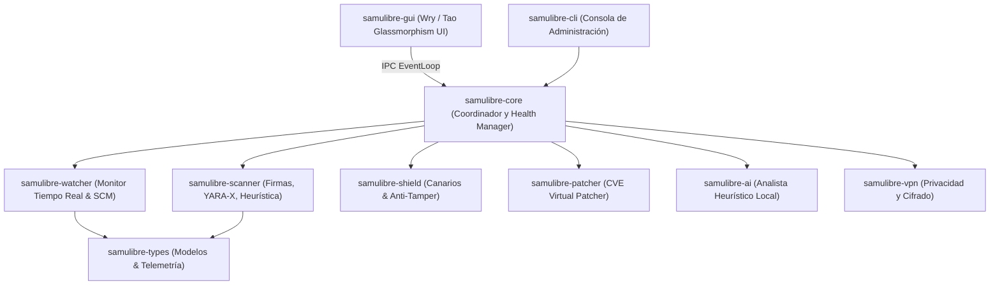

# 🛡️ SamuLibre Endpoint Protection Suite

[](VERSION)
[](LICENSE)
[](https://www.rust-lang.org/)
[](https://github.com/saghet/SamuLibre)
[](.github/workflows/ci.yml)
[](SECURITY.md)

> **[English Version](README_EN.md)** | **[Documentación Técnica](docs/)** | **[Hoja de Ruta](ROADMAP.md)** | **[Seguridad](SECURITY.md)**

---

## 1. DESCRIPCIÓN GENERAL

**SamuLibre** es una suite de ciberseguridad, antivirus y protección de endpoints (*EDR*) de código abierto, desarrollada en **Rust**. Diseñada con una arquitectura modular de alto rendimiento, proporciona supervisión del sistema de archivos en tiempo real, detección de malware multicapa (firmas SHA-256, reglas YARA-X y heurística de entropía Shannon), bóveda de cuarentena cifrada, mitigación autónoma de vulnerabilidades (*Virtual Patching*) y servicio en segundo plano integrado con el *Service Control Manager* (SCM) de Windows.

SamuLibre opera bajo el principio de **cero telemetría invasiva**, garantizando que ningún dato privado, metadato de usuario o archivo del sistema sea enviado a servidores de terceros.

---

## 2. PROBLEMA QUE RESUELVE

1. **Opacidad y Telemetría Masiva:** La mayoría de soluciones comerciales recopilan metadatos continuos y telemetría de comportamiento sin control del usuario.
2. **Consumo Excesivo de Recursos:** Antivirus convencionales demandan entre 150 MB y 800 MB de memoria RAM en reposo, ralentizando estaciones de trabajo y baterías de portátiles.
3. **Dependencia Lenta de Parches de Seguridad:** Cuando se descubre una vulnerabilidad crítica (0-Day / CVE), los endpoints quedan desprotegidos hasta que el fabricante del sistema operativo publica una actualización oficial.
4. **Falsas Sensaciones de Seguridad:** Muchas herramientas libres simulan protección sin integrarse con los mecanismos de seguridad nativos del sistema operativo (servicios Win32, ACLs, UAC).

SamuLibre resuelve esto con un consumo inferior a **40 MB de RAM**, inspección sub-milisegundo, mitigación virtual autónoma y código fuente 100% auditable.

---

## 3. CARACTERÍSTICAS TÉCNICAS VERIFICADAS

- **Protección en Tiempo Real (RealTime Guard):**
  - Monitor residente de sistema de archivos en espacio de usuario y como **Servicio Windows 24/7 (SCM)** bajo `NT AUTHORITY\SYSTEM`.
  - Cola de eventos priorizada con capacidad para 10,000 eventos concurrentes y limitación adaptativa de carga.
  - Caché de archivos limpios (*Fast-Path*) en memoria con latencia inferior a **0.05 ms** por acceso verificado.
- **Motor de Detección Multicapa:**
  - Base de firmas criptográficas SHA-256 optimizada en RAM.
  - Motor de reglas heurísticas **YARA-X** compiladas e indexadas.
  - Análisis de entropía Shannon para detección de empaquetadores maliciosos (*UPX, Themida, packers polimórficos*).
  - Detección de scripts maliciosos en PDFs y técnicas de evasión AMSI.
- **Bóveda de Cuarentena Segura:**
  - Aislamiento automático de archivos sospechosos cifrados con algoritmo XOR reversible.
  - Preservación íntegra de metadatos forenses (ruta original, hash SHA-256, timestamp, vector de detección).
- **Parchado Virtual Autónomo (Virtual Patcher):**
  - Auditoría de vulnerabilidades locales frente a boletines oficiales de seguridad.
  - Aplicación de mitigaciones de registro y cortafuegos en memoria sin requerir reinicio del equipo.
  - Reversión automática (*Auto-Rollback*) cuando se detecta la instalación de la KB oficial de Windows Update.
- **Canarios Anti-Ransomware:**
  - Despliegue de señuelos señuelo estratégicos (*honeytokens*) con monitoreo diferencial de escrituras masivas.
- **Health Manager de Protección:**
  - Monitoreo continuo de la salud operativa de los 9 subsistemas de defensa, auditables bajo demanda y verificables con el comando `samulibre health`.

---

## 4. ARQUITECTURA DEL SISTEMA

El proyecto se estructura como un **Rust Cargo Workspace** altamente modular compuesto por 11 crates independientes:



---

## 5. REQUISITOS DEL SISTEMA

### Requisitos Mínimos:
- **Procesador:** CPU x86_64 de 64 bits (1.0 GHz o superior).
- **Memoria RAM:** 512 MB disponibles (SamuLibre consume < 45 MB).
- **Almacenamiento:** 100 MB de espacio libre en disco.
- **Sistema Operativo:** Windows 10 (versión 1809+), Windows 11 o Linux con kernel 5.4+.

### Requisitos Recomendados:
- **Procesador:** CPU multinúcleo con soporte de instrucciones AVX2 (Intel Core i3/i5/i7/i9 8va Gen+, AMD Ryzen).
- **Memoria RAM:** 2 GB o superior.
- **Almacenamiento:** Unidad de estado sólido (SSD) NVMe/SATA.
- **Sistema Operativo:** Windows 11 (22H2 / 23H2 / 24H2) de 64 bits con soporte de elevación UAC.

---

## 6. TECNOLOGÍAS UTILIZADAS

- **Lenguaje Central:** Rust (Edición 2021, v1.80+) — Garantía de seguridad de memoria sin recolector de basura (*No GC*).
- **Interfaz de Usuario:** Wry 0.57 / Tao 0.37 (WebView2 nativo de Windows / WebKitGTK en Linux).
- **Monitoreo de Archivos:** Crate `notify` v6.1 con enlaces Win32 `ReadDirectoryChangesW` / `inotify`.
- **Integración con Servicios del Sistema:** Crate `windows-service` v0.8.1 (Win32 Service Control Manager).
- **Motor Heurístico:** Entropía de Shannon, Hashes SHA-256 con SIMD, motor YARA-X y parsing PE/ELF.
- **Criptografía:** `sha2`, `hex`, algoritmos de aislamiento de cuarentena y consultas k-anonymity.

---

## 7. INSTALACIÓN Y PUESTA EN MARCHA

### Opción 1: Ejecución Rápida Portable
1. Descarga el paquete binario oficial desde [Releases](https://github.com/saghet/SamuLibre/releases/latest).
2. Extrae el contenido en cualquier carpeta (ej. `C:\Program Files\SamuLibre` o tu directorio de usuario).
3. Ejecuta `samulibre-gui.exe`.

### Opción 2: Instalación del Servicio Windows 24/7 (Protección Permanente)
Para que el antivirus proteja el equipo de forma ininterrumpida antes del inicio de sesión:
- **Desde la Interfaz Gráfica:** Ve a la pestaña **Protección en Tiempo Real** y pulsa el botón **`🛡 Instalar Servicio Windows (UAC)`**. Acepta el cuadro de confirmación de administrador de Windows.
- **Desde Consola (PowerShell como Administrador):**
  ```powershell
  cd "C:\Ruta\A\SamuLibre"
  .\samulibre.exe service install
  .\samulibre.exe service start
  ```

### Opción 3: Compilación desde el Código Fuente
```bash
# 1. Clonar el repositorio
git clone https://github.com/saghet/SamuLibre.git
cd SamuLibre

# 2. Ejecutar la batería de pruebas
cargo test --workspace

# 3. Compilar en modo Release optimizado
cargo build --release -p samulibre-gui -p samulibre-cli
```

---

## 8. CONFIGURACIÓN Y USO

### Comandos de Línea de Comandos (`samulibre.exe`):
```bash
# Diagnóstico de salud integral de los 9 subsistemas
samulibre.exe health

# Escaneo rápido de una carpeta o archivo sospechoso
samulibre.exe scan C:\Users\Usuario\Downloads

# Escaneo con motor heurístico profundo
samulibre.exe scan --deep C:\Archivos

# Estado del servicio de fondo
samulibre.exe service status

# Autodiagnóstico funcional del motor en tiempo real
samulibre.exe service autodiagnostic
```

---

## 9. LIMITACIONES CONOCIDAS Y DESCARGO DE RESPONSABILIDAD

> [!IMPORTANT]
> **Aviso de Responsabilidad Legal y Técnica:**  
> SamuLibre es un proyecto de software de ciberseguridad libre desarrollado con estándares rigurosos de ingeniería. Sin embargo, **hasta que no culmine los procesos de certificación independiente formal en laboratorios acreditados (tales como AV-TEST, AV-Comparatives o VB100), SamuLibre no debe considerarse un sustituto comercial certificado para entornos corporativos de misión crítica con requerimientos regulatorios específicos (ej. PCI-DSS, HIPAA)**. Se recomienda mantener habilitados los mecanismos nativos de defensa del sistema operativo según las políticas de seguridad de su organización.

Otras limitaciones técnicas actuales:
- La interceptación de archivos en tiempo real opera a nivel de espacio de usuario (*User-Space Notification*) y servicio SCM (*LocalSystem*). La interceptación a nivel de Ring 0 (Windows File System Minifilter Driver `samulibre.sys`) está planificada para la versión 2.2 según el [Roadmap](ROADMAP.md).
- El motor de firmas actual incluye conjuntos de hashes curados y reglas YARA de referencia; no contiene las bases masivas multiterabyte de firmas comerciales privativas.

---

## 10. POLÍTICA DE SEGURIDAD Y REPORTE DE VULNERABILIDADES

Para conocer cómo reportar vulnerabilidades de forma responsable, consulte nuestra [Política de Seguridad (SECURITY.md)](SECURITY.md).  
**Por política de seguridad, está terminantemente prohibido incorporar malware activo al repositorio.**

---

## 11. LICENCIA

Este proyecto está licenciado bajo los términos de la **GNU General Public License v3.0 or later** ([GPL-3.0-or-later](LICENSE)).

Para acuerdos comerciales duales, integraciones propietarias o soporte empresarial, consulte con el equipo mantenedor.

---

## 12. CONTACTO Y SOPORTE

- **Repositorio Oficial:** [https://github.com/saghet/SamuLibre](https://github.com/saghet/SamuLibre)
- **Reporte de Errores y Sugerencias:** [GitHub Issues](https://github.com/saghet/SamuLibre/issues)
- **Comunidad y Soporte Técnico:** `dev@samulibre.org`
