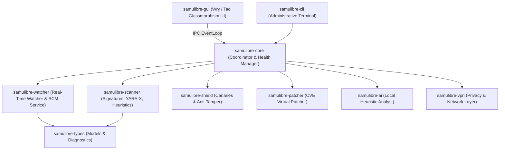

# 🛡️ SamuLibre Endpoint Protection Suite

[](VERSION)
[](LICENSE)
[](https://www.rust-lang.org/)
[](https://github.com/saghet/SamuLibre)
[](.github/workflows/ci.yml)
[](SECURITY.md)

> **[Versión en Español](README.md)** | **[Technical Docs](docs/)** | **[Roadmap](ROADMAP.md)** | **[Security](SECURITY.md)**

---

## 1. EXECUTIVE OVERVIEW

**SamuLibre** is an enterprise-grade, open-source cybersecurity, antivirus, and endpoint protection suite (*EDR*) built from scratch in pure **Rust**. Engineered with a high-performance modular architecture, it delivers real-time filesystem protection, multi-engine threat detection (SHA-256 signatures, compiled YARA-X rules, and Shannon entropy heuristics), an encrypted quarantine vault, autonomous zero-day virtual patching, and background protection integrated with the Windows **Service Control Manager (SCM)**.

SamuLibre adheres to a strict **zero-telemetry** standard: no private user data, system metadata, or files are ever exfiltrated to third-party cloud servers.

---

## 2. KEY VALUE PROPOSITIONS

1. **Complete Auditability & Zero Telemetry:** Unlike proprietary antivirus products that continuously monitor and upload user behavior telemetry, SamuLibre is 100% open-source and respects user sovereignty.
2. **Minimal Resource Footprint:** Traditional solutions consume 150 MB to 800+ MB of RAM at idle. SamuLibre idles at **less than 40 MB of RAM**, conserving laptop battery and preserving developer workstation responsiveness.
3. **Autonomous Virtual Patching:** When critical 0-day vulnerabilities (CVEs) emerge, endpoints often remain vulnerable for weeks awaiting vendor updates. SamuLibre's Virtual Patcher applies in-memory and registry mitigations immediately without requiring reboots.
4. **Honest, Fact-Checked Telemetry:** SamuLibre does not hallucinate security status. If a subsystem is unconfigured or stopped, the UI and CLI transparently reflect its true technical state.

---

## 3. VERIFIED CORE CAPABILITIES

- **Real-Time Guard:**
  - Filesystem watcher operating in user-space and as a persistent Windows 24/7 Service under `NT AUTHORITY\SYSTEM`.
  - Prioritized event queue with 10,000-event capacity and adaptive backpressure.
  - In-memory Clean Hash Cache (*Fast-Path*) providing sub-0.05 ms latency on safe file operations.
- **Multi-Layer Detection Engine:**
  - Fast SHA-256 cryptographic signature lookup in RAM.
  - Compiled and indexed **YARA-X** rule engine.
  - Shannon entropy calculator identifying packed and obfuscated executables (*UPX, Themida, polymorphic packers*).
  - Malicious active script detection in PDFs and AMSI bypass identification.
- **Secure Quarantine Vault:**
  - Automatic isolation of threats using reversible XOR encryption.
  - Preserves comprehensive forensic metadata (source path, SHA-256 hash, detection vector, timestamp).
- **Autonomous Virtual Patcher:**
  - Audits local system vulnerabilities against official security advisories.
  - Automatically mitigates risks without requiring system reboots.
  - Features automatic rollback (*Auto-Rollback*) upon detecting official Windows Update KBs.
- **Ransomware Tripwire Canaries:**
  - Strategic deployment of honeytoken decoy files with differential write alerting.
- **Protection Health Manager:**
  - Continuous runtime audit of all 9 defense subsystems, verifiable on-demand via `samulibre health`.

---

## 4. ARCHITECTURE

Organized as a modular **Rust Cargo Workspace** comprising 11 decoupled crates:



---

## 5. SYSTEM REQUIREMENTS

### Minimum Requirements:
- **Processor:** 64-bit x86_64 CPU (1.0 GHz or higher).
- **RAM:** 512 MB available (SamuLibre idles at < 45 MB).
- **Storage:** 100 MB free disk space.
- **OS:** Windows 10 (Build 1809+), Windows 11, or Linux (Kernel 5.4+).

### Recommended Requirements:
- **Processor:** Multi-core modern CPU with AVX2 instruction support.
- **RAM:** 2 GB or more.
- **Storage:** NVMe / SATA Solid State Drive (SSD).
- **OS:** Windows 11 (22H2 / 23H2 / 24H2) x64 with UAC elevation support.

---

## 6. INSTALLATION & USAGE

### Portable Execution:
1. Download the latest release package from [Releases](https://github.com/saghet/SamuLibre/releases/latest).
2. Extract to a local directory (e.g. `C:\Program Files\SamuLibre`).
3. Run `samulibre-gui.exe`.

### Windows 24/7 Service Setup (Persistent Protection):
- **Via Graphical UI:** Open the **Real-Time Protection** tab and click **`🛡 Instalar Servicio Windows (UAC)`**. Accept the Windows Administrator prompt.
- **Via Administrator PowerShell:**
  ```powershell
  cd "C:\Path\To\SamuLibre"
  .\samulibre.exe service install
  .\samulibre.exe service start
  ```

### Build from Source:
```bash
git clone https://github.com/saghet/SamuLibre.git
cd SamuLibre
cargo test --workspace
cargo build --release -p samulibre-gui -p samulibre-cli
```

---

## 7. DISCLAIMER & KNOWN LIMITATIONS

> [!IMPORTANT]
> **Legal and Technical Disclaimer:**  
> SamuLibre is an open-source cybersecurity project engineered to rigorous software standards. However, **until formal independent certification is finalized with accredited testing laboratories (such as AV-TEST, AV-Comparatives, or VB100), SamuLibre should not be considered a certified replacement for commercial enterprise endpoint suites in regulated compliance environments (e.g., PCI-DSS, HIPAA)**. Users are encouraged to maintain native operating system defenses in accordance with their organization's policies.

---

## 8. LICENSE

Licensed under the **GNU General Public License v3.0 or later** ([GPL-3.0-or-later](LICENSE)).  
Commercial dual-licensing, custom OEM integrations, and enterprise support agreements are available upon inquiry.

---

## 9. CONTACT & COMMUNITY

- **Repository:** [https://github.com/saghet/SamuLibre](https://github.com/saghet/SamuLibre)
- **Issues & Vulnerability Reports:** [GitHub Issues](https://github.com/saghet/SamuLibre/issues) / [SECURITY.md](SECURITY.md)
- **Developer Contact:** `dev@samulibre.org`
