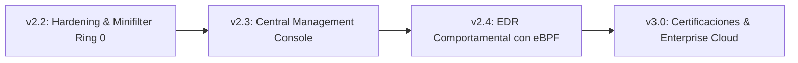

# Hoja de Ruta Tecnológica (Roadmap) — SamuLibre

Este documento describe la visión técnica, estratégica y arquitectónica para la evolución de **SamuLibre** desde su base actual hasta convertirse en una plataforma de protección de endpoints (*EDR/XDR*) y antivirus open-source de nivel comercial e institucional.

---

## 🎯 Visión General

Consolidar a SamuLibre como la solución de ciberseguridad abierta, auditable, libre de anuncios y con cero fugas de telemetría de referencia mundial para usuarios individuales, pequeñas y medianas empresas y administraciones públicas.

---

## 🚀 Fases del Roadmap

### Fase 1: Kernel Hardening y Minifilter Ring 0 (Q1 2027 - v2.2)
- **Windows File System Minifilter Driver (`samulibre.sys`):**
  - Implementación de un driver de minifiltro firmado de sistema de archivos (`FLTMGR`) para interceptación previa a la escritura (`Pre-Operation Callback`).
  - Bloqueo preventivo de procesos antes de que el archivo toque el disco físico, superando el modelo reactivo de espacio de usuario.
- **Integración con ETW (Event Tracing for Windows):**
  - Monitoreo de creación de procesos (`Microsoft-Windows-Kernel-Process`), manipulación de memoria (`VirtualAllocEx` / `WriteProcessMemory`) y conexiones de red en tiempo real.
- **Protección Antimanipulación de Procesos (PPL / Protected Process Light):**
  - Protección del proceso del servicio ante cierres forzados por herramientas de debugging o administradores comprometidos.

---

### Fase 2: Consola de Administración Centralizada (Q2 2027 - v2.3)
- **Panel Web para Gestión de Flotas (Multi-Tenant Dashboard):**
  - Visibilidad centralizada de incidentes, alertas de ransomware y estado de parches virtuales en múltiples equipos.
- **Distribución de Políticas y Exclusiones Remotas:**
  - Envío seguro de firmas y reglas de firewall adaptativo mediante protocolo gRPC con TLS mutuo (mTLS).
- **Exportación a SIEM / Syslog / CEF:**
  - Conectores nativos para Splunk, Microsoft Sentinel, Elastic Security y Wazuh.

---

### Fase 3: EDR Comportamental Avanzado y eBPF en Linux (Q3 2027 - v2.4)
- **Soporte Nativo de eBPF en Linux:**
  - Interceptación de llamadas al sistema (`sys_enter_execve`, `sys_enter_connect`, `sys_enter_openat`) con sobrecarga de CPU inferior al 1%.
- **Árbol de Procesos y Detección de Técnicas MITRE ATT&CK:**
  - Correlación de comportamientos sospechosos (ej. `powershell.exe -enc` spawned por `winword.exe` o `cmd.exe`).
- **Aislamiento de Red Automático:**
  - Capacidad de aislar un endpoint infectado de la red local preservando únicamente el canal de gestión con el administrador.

---

### Fase 4: Certificaciones de la Industria y Ecosistema Comercial (Q4 2027 - v3.0)
- **Certificaciones Internacionales de Detección:**
  - Someter el motor a pruebas de validación en laboratorios independientes (**AV-TEST**, **AV-Comparatives**, **Virus Bulletin VB100**).
- **Modelo de Licenciamiento Dual (Comercial / AGPLv3):**
  - Ofrecer soporte empresarial 24/7, acuerdos de nivel de servicio (SLA) y licencias OEM para fabricantes de hardware o distribuidores de seguridad gestionada (MSSPs).
- **Federación Comunitaria de Inteligencia de Amenazas:**
  - Red descentralizada y anónima basada en consultas *k-anonymity* para compartir indicadores de compromiso (IoCs) sin exponer datos confidenciales de los usuarios.
