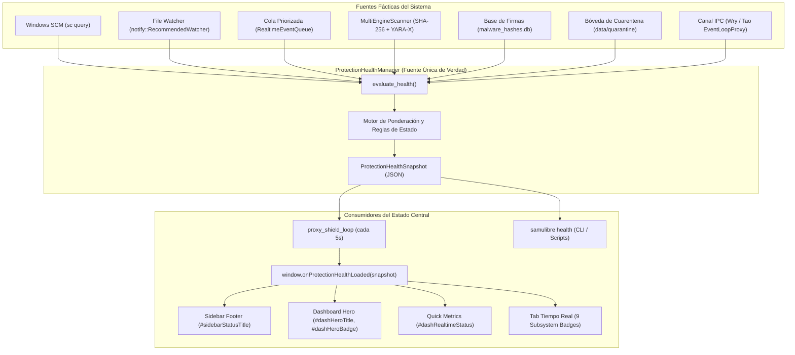

# ARQUITECTURA DEL PROTECTION HEALTH MANAGER (FUENTE ÚNICA DE VERDAD)

**Proyecto:** SamuLibre Antivirus & Endpoint Detection  
**Módulo:** ProtectionHealthManager  
**Versión:** 2.1.14  
**Autor:** Principal Software Architect & IPC Engineer  

---

## 1. OBJETIVO Y PRINCIPIOS DE DISEÑO

El `ProtectionHealthManager` es el árbitro y recolector centralizado de telemetría de SamuLibre. Resuelve de raíz el problema de estados contradictorios entre la barra de navegación, el panel de inicio y la pestaña de protección en tiempo real.

### Principios Rectores:
1. **Cero Tolerancia a Estados Simulados (Anti-Hallucination):** Ningún indicador de la interfaz gráfica puede mostrarse en color verde a menos que el subsistema subyacente presente evidencia fáctica, verificada en tiempo real.
2. **Normalización Estricta de Estados:** Todos los subsistemas reportan bajo una única enumeración normalizada (`SubsystemState`):
   - `RUNNING`: El subsistema está en ejecución y sus comprobaciones funcionales son satisfactorias.
   - `STOPPED`: El subsistema está explícitamente detenido.
   - `STARTING`: En fase de inicialización o arranque.
   - `DEGRADED`: El subsistema funciona pero con limitaciones (ej. protección en espacio de usuario en lugar de servicio 24/7, o eventos descartados por saturación de cola).
   - `FAILED`: Error o excepción crítica en el subsistema.
   - `NOT_INSTALLED`: El binario o servicio no está registrado en el sistema operativo.
   - `NOT_CONFIGURED`: Falta configuración o archivos necesarios.
   - `NOT_TESTED`: El subsistema no ha sido sometido a pruebas de diagnóstico en la sesión.
   - `UNKNOWN`: Estado indeterminado.

3. **Diferenciación Clave:**
   - `NOT_TESTED` **no** significa `FAILED`.
   - `RUNNING` **no** significa automáticamente que el motor sea invulnerable o esté interceptando malware si las firmas no están cargadas.

---

## 2. DIAGRAMA ARQUITECTÓNICO DEL COLECTOR CENTRAL



---

## 3. ESPECIFICACIÓN DE TIPOS Y ESTRUCTURAS

### 3.1 Enumeración de Estados Normalizados (`SubsystemState`)
```rust
#[derive(Debug, Clone, Copy, PartialEq, Eq, Serialize, Deserialize)]
pub enum SubsystemState {
    Running,
    Stopped,
    Starting,
    Degraded,
    Failed,
    NotInstalled,
    NotConfigured,
    NotTested,
    Unknown,
}
```

### 3.2 Reporte Individual de Subsistema (`SubsystemHealthReport`)
```rust
#[derive(Debug, Clone, Serialize, Deserialize)]
pub struct SubsystemHealthReport {
    pub name: String,
    pub state: SubsystemState,
    pub checked_at: String,
    pub last_event: Option<String>,
    pub last_error: Option<String>,
    pub version: Option<String>,
    pub metrics: HashMap<String, String>,
    pub evidence: String,
}
```

### 3.3 Instantánea Global de Protección (`ProtectionHealthSnapshot`)
```rust
#[derive(Debug, Clone, Serialize, Deserialize)]
pub struct ProtectionHealthSnapshot {
    pub overall_status: SubsystemState,
    pub overall_status_label: String,
    pub overall_status_color: String, // "green", "yellow", "red", "gray"
    pub checked_at: String,
    pub subsystems: Vec<SubsystemHealthReport>,
    pub active_watch_dirs: Vec<String>,
    pub telemetry: RealtimeTelemetry,
    pub evidence_summary: String,
}
```

---

## 4. MATRIZ DE REGLAS DE DECISIÓN GLOBAL

| Condición de los Subsistemas | Estado Global Asignado | Color en UI | Etiqueta en Pantalla |
| :--- | :--- | :--- | :--- |
| Fallo en Base de Firmas o Bóveda de Cuarentena inaccesible | `SubsystemState::Failed` | 🔴 **ROJO** | `ERROR CRÍTICO EN MOTOR` |
| Servicio Windows SCM activo y Watcher activo con firmas válidas | `SubsystemState::Running` | 🟢 **VERDE** | `PROTECCIÓN TOTAL ACTIVA (SERVICIO WINDOWS 24/7)` |
| Watcher activo en espacio de usuario pero servicio SCM no instalado/detenido | `SubsystemState::Degraded` | 🟡 **AMARILLO** | `PROTECCIÓN PARCIAL (MODO USUARIO / GUI)` |
| Watcher detenido y Servicio Windows SCM detenido | `SubsystemState::Stopped` | 🔴 **ROJO** | `PROTECCIÓN DESACTIVADA` |
| Sin verificación inicial previa o componentes en arranque | `SubsystemState::NotTested` | ⚪ **GRIS** | `ESTADO EN VERIFICACIÓN` |
