# ESPECIFICACIÓN ARQUITECTÓNICA DEL CONTROLADOR MINIFILTRO WINDOWS
## SamuLibre File System Minifilter Driver (`samu_flt.sys`)
**Proyecto:** SamuLibre Endpoint Protection Suite  
**Clasificación:** Diseño Técnico de Kernel-Mode (Pre-Implementación y Validación de Seguridad)  
**Compatibilidad:** Windows 10 (21H2+) / Windows 11 (22H2, 23H2, 24H2) x64 & ARM64  
**Estándar de Seguridad:** HVCI (Hypervisor-Protected Code Integrity), WHQL y Mínimo Privilegio  

---

## 1. OBJETIVO TÉCNICO Y JUSTIFICACIÓN

La auditoría de la Fase 1 evidenció que la interceptación basada en `notify` (`ReadDirectoryChangesW`) es **reactiva (Post-I/O)**, lo que genera una ventana de vulnerabilidad (condición de carrera) frente a malware 0-Day y ransomware en evaluaciones independientes (AV-TEST y AV-Comparatives).

Para alcanzar el nivel de protección de los líderes de la industria, SamuLibre requiere un **Controlador de Filtro del Sistema de Archivos (Minifilter Driver)** operando bajo el Filter Manager (`FLTMGR.SYS`) de Microsoft Windows, capaz de interceptar solicitudes de apertura, lectura, modificación y ejecución **antes** de que el subsistema NTFS/ReFS las procese (`FLT_PRE_OPERATION`).

> **REGLA DE SEGURIDAD ESTRICTA:**  
> Conforme a las directrices del proyecto, no se deben compilar ni cargar controladores de kernel experimentales sin firma digital ni aislamiento en equipos de producción. Este documento establece la arquitectura formal, los mecanismos de comunicación y los procedimientos de laboratorio para su despliegue controlado.

---

## 2. PARÁMETROS DEL FILTER MANAGER DE WINDOWS

| Parámetro | Valor Asignado | Justificación de Arquitectura |
| :--- | :--- | :--- |
| **Nombre del Driver** | `samu_flt.sys` | Binario de kernel desacoplado. |
| **Banda de Altitud** | `320000 - 329999` (FSFilter Anti-Virus) | Banda oficial asignada por Microsoft para productos Antivirus. |
| **Altitud Específica** | `328500` | Posicionado por encima de filtros de backup/cifrado y por debajo de minifiltros de compresión. |
| **Instancia del Filtro** | `SamuLibre Instance` | Registro por volumen NTFS, FAT32, exFAT y ReFS. |
| **Flags de Inicio** | `SERVICE_SYSTEM_START` (1) | Carga temprana durante el arranque del kernel de Windows. |

---

## 3. PUNTOS DE INTERCEPTACIÓN (OPERATIONS & CALLBACKS)

El controlador intercepta exclusivamente las operaciones críticas (`IRP_MJ`) bajo el principio de mínimo privilegio para evitar sobrecarga del sistema:

### A. `IRP_MJ_CREATE` (`PreCreate` / `FLT_PREOP_SYNCHRONIZE`)
- **Propósito:** Interceptación On-Access y On-Execution.
- **Lógica de Decisión:**
  1. Si `Data->Iopb->Parameters.Create.SecurityContext->DesiredAccess` incluye `FILE_EXECUTE` o `GENERIC_EXECUTE`:
     - El archivo es un ejecutable o biblioteca dinámica (`.exe`, `.dll`, `.sys`).
     - Se envía una solicitud de inspección sincrónica al demonio de espacio de usuario (`samulibre-watcher`) vía Communication Port.
  2. Si el archivo está catalogado como limpio en la caché compartida de kernel (`KernelCleanCache`), se retorna de inmediato `FLT_PREOP_SUCCESS_NO_CALLBACK` (< 5 microsegundos).
  3. Si la respuesta de espacio de usuario es `BLOCK_INFECTED`:
     - Se deniega la operación devolviendo `STATUS_ACCESS_DENIED` y `FLT_PREOP_COMPLETE`.
     - El archivo malicioso **nunca llega a abrirse ni ejecutarse**.

### B. `IRP_MJ_CLEANUP` & `IRP_MJ_CLOSE` (`PostCleanup`)
- **Propósito:** Inspección post-escritura (On-Write).
- **Lógica de Decisión:**
  - Si el archivo fue modificado (`FO_FILE_MODIFIED`), se encola asíncronamente para re-análisis completo en espacio de usuario.

### C. `IRP_MJ_WRITE` (`PreWrite`)
- **Propósito:** Anti-Ransomware a nivel de bloques.
- **Lógica de Decisión:**
  - Monitoreo de ráfagas masivas de escrituras con alta entropía en extensiones de documentos de usuario (`.docx`, `.xlsx`, `.pdf`).

---

## 4. COMUNICACIÓN KERNEL-TO-USER (INVERTED CALL PATTERN)

Para evitar bloqueos en el kernel y proteger la estabilidad de Windows, la comunicación se estructura mediante un **Puerto de Comunicación de Filtro** (`FilterCommunicationPort`):

```mermaid
sequenceDiagram
    participant K as SamuLibre Minifilter (Kernel-Mode)
    participant P as Filter Manager (FLTMGR.SYS)
    participant U as SamuLibre Service (User-Mode Core)
    participant S as MultiEngineScanner & Cache

    U->>P: FilterConnectCommunicationPort("\\SamuLibrePort")
    P-->>K: FltCreateCommunicationPort Listener
    K->>U: Puntero de canal IPC establecido

    Note over K,U: Inverted Call Loop (Worker Threads en User-Mode)
    U->>K: FilterGetMessage (Esperando solicitud de I/O)

    rect rgb(30, 40, 60)
    Note over K: Aplicación intenta ejecutar malware.exe (PreCreate)
    K->>K: ¿Hash en Kernel Clean Cache? (NO)
    K->>U: Despacho de Evento (PID, Ruta, Handle, Contexto)
    U->>S: MultiEngineScanner::scan_file()
    S-->>U: ScanResult (Infected)
    U->>K: FilterReplyMessage (STATUS_ACCESS_DENIED)
    Note over K: Kernel bloquea I/O antes de ejecución
    end
```

### Mecanismo de Seguridad Fail-Open (Anti-BSOD)
- Si el proceso en espacio de usuario no responde dentro de un timeout estricto de **2,500 ms**, el minifiltro libera la solicitud con `FLT_PREOP_SUCCESS_NO_CALLBACK` (Fail-Open temporal) y registra un evento crítico en el Event Log de Windows. Esto **impide categóricamente que una sobrecarga en espacio de usuario cause un pantallazo azul (BSOD)**.

---

## 5. REQUISITOS DE FIRMA Y COMPATIBILIDAD CON WINDOWS 11

1. **Cumplimiento con HVCI / Core Isolation:**
   - Cero páginas de memoria ejecutables y modificables simultáneamente (`W^X` estricto en kernel).
   - Uso de `ExAllocatePool2` con `POOL_FLAG_NON_PAGED` en lugar de las APIs obsoletas `ExAllocatePoolWithTag`.
2. **Firma Digital de Controladores:**
   - Certificado de Firma de Código EV (Extended Validation).
   - Sometimiento al portal de Microsoft Hardware Dev Center para certificación **WHQL** y atestación de firma para Windows 11.
3. **Control de Acceso al Puerto:**
   - El puerto de comunicación del minifiltro requiere un descriptor de seguridad (`SECURITY_DESCRIPTOR`) que restringe el acceso exclusivamente a `NT AUTHORITY\SYSTEM` y administradores locales con el privilegio `SeDebugPrivilege`.
