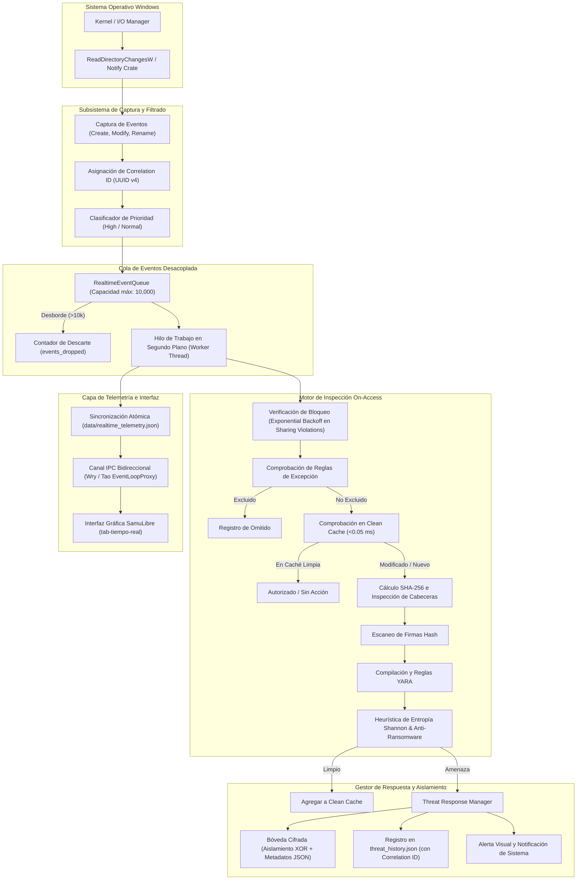

# ARQUITECTURA TÉCNICA DEL MOTOR DE PROTECCIÓN EN TIEMPO REAL

**Proyecto:** SamuLibre Antivirus & Endpoint Detection  
**Módulo:** RealTime Watcher & Protection Service  
**Versión:** 2.1.14 (Arquitectura Multicapa Desacoplada)  
**Autor:** Chief Security Architect & Windows Systems Engineer  

---

## 1. VISIÓN GENERAL Y PRINCIPIOS DE DISEÑO

La nueva arquitectura de protección en tiempo real de SamuLibre está diseñada para operar como una solución modular, desacoplada y de alta resiliencia. Separa estrictamente el ciclo de vida del motor de análisis respecto de la interfaz gráfica de usuario (GUI), garantizando que el endpoint permanezca protegido 24/7 incluso ante cierres intencionales o accidentales de la ventana de la aplicación.

### Principios Fundamentales:
- **Desacoplamiento GUI / Servicio:** La GUI actúa únicamente como una consola de visualización y control (telemetría e IPC). El motor de supervisión reside en un proceso de fondo o servicio de Windows.
- **Trazabilidad de Extremo a Extremo (Correlation Tracking):** Cada evento de archivo generado en Windows recibe un `correlation_id` (UUID v4) y un `trace_id` que se propaga a lo largo de toda la tubería.
- **Contrapresión y Límite de Memoria (Bounded Queues):** La cola de eventos tiene una capacidad máxima de 10,000 elementos, previniendo ataques de denegación de servicio local (DoS por saturación de eventos de archivo).
- **Priorización de Rutas Sensibles:** Eventos provenientes de carpetas de alta exposición (como `%USERPROFILE%\Downloads`, `%TEMP%`, `AppData\Local\Temp`) se clasifican como `EventPriority::High` y se procesan antes que modificaciones rutinarias.
- **Fast-Path mediante Caché Limpia:** Archivos validados previamente y cuyo tamaño y fecha de modificación no han cambiado se resuelven en menos de 0.05 milisegundos sin recalcular hashes SHA-256.

---

## 2. DIAGRAMA DE FLUJO Y TUBERÍA DE EVENTOS

---

## 3. COMPONENTES CLAVE DEL SUBSISTEMA

### 3.1 Controlador de Servicio Windows y Demonio (`samulibre-watcher::service`)
El módulo `service.rs` proporciona capacidades completas de gestión de ciclo de vida:
- **`is_service_or_daemon_running()`:** Comprueba si el proceso de fondo está en ejecución verificando el PID registrado en `data/realtime_service.pid` o consultando el Service Control Manager (SCM) mediante `sc query SamuLibreService`.
- **`install_windows_service()`:** Registra el binario CLI como un servicio de arranque automático mediante `sc create SamuLibreService binPath= "..." start= auto`.
- **`start_service()` / `stop_service()`:** Envía señales de inicio o detención controlada.
- **`record_service_pid()` / `remove_service_pid()`:** Control atómico del fichero de PID con verificación de si el proceso correspondiente sigue vivo en Windows.

### 3.2 Cola de Eventos Priorizada (`RealtimeEventQueue`)
- Implementada mediante `std::sync::{Mutex, Condvar}` y `std::collections::VecDeque<RealtimeFileEvent>`.
- **Estructura de Prioridades:** Los eventos marcados como `High` se insertan al frente de la cola de procesamiento mediante `push_front`, asegurando que archivos descargados en la carpeta de descargas o creados en `%TEMP%` sean inspeccionados inmediatamente.
- **Prevención de Agotamiento de Recursos:** Capacidad máxima acotada a `MAX_QUEUE_CAPACITY = 10,000`. Si la cola se satura, los eventos normales más antiguos son descartados de manera segura y se incrementa el contador atómico `events_dropped_total`, notificando en la telemetría.

### 3.3 Motor de Inspección On-Access con Manejo de Bloqueos
- **Backoff en Errores de Bloqueo (`Sharing Violations`):** Si un proceso creador mantiene el archivo abierto con bloqueo exclusivo (`ErrorKind::PermissionDenied`), el motor ejecuta hasta 3 reintentos con esperas exponenciales de 20ms, 40ms y 80ms antes de abortar o registrar una advertencia.
- **Inspección Rápida y Aislamiento Atómico:**
  1. Si se detecta una amenaza por firma o regla YARA, el archivo se traslada atómicamente a la bóveda de cuarentena (`data/quarantine`).
  2. El payload del archivo se cifra mediante XOR con la clave maestra interna de la bóveda para impedir su ejecución accidental o rescate por malware.
  3. Se genera un archivo de metadatos `.json` con la ruta original, hash, tamaño, fecha de aislamiento y severidad.

### 3.4 Sincronización de Telemetría Atómica
El motor actualiza en memoria la estructura `RealtimeTelemetry` y la vuelca de manera atómica a `data/realtime_telemetry.json`:
- `status`: Estado actual según la enumeración de 6 niveles (`Active`, `Initializing`, `Partial`, `Disabled`, `Error`, `Unverified`).
- `service_running` / `watcher_running`: Banderas de estado real del proceso de fondo.
- `queue_depth`, `events_enqueued_total`, `events_processed_total`, `events_dropped_total`.
- `files_inspected_total`, `threats_intercepted_total`.
- `last_event_path`, `last_event_timestamp`.
- `uptime_seconds`.

Tanto la interfaz gráfica como el comando CLI `samulibre service status` o `samulibre watcher status` leen directamente esta telemetría compartida, eliminando discrepancias entre herramientas.
