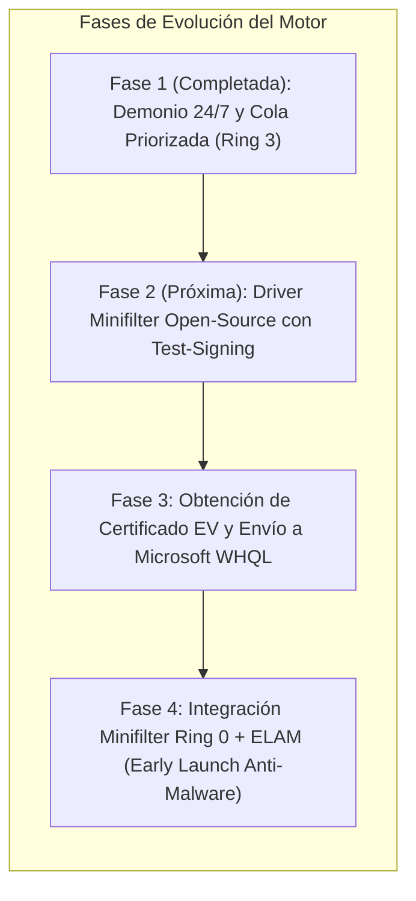

# LIMITACIONES CONOCIDAS, FRONTERAS DE USUARIO Y HOJA DE RUTA MINIFILTER

**Proyecto:** SamuLibre Antivirus & Endpoint Detection  
**Módulo:** RealTime Watcher & Kernel Architecture Roadmap  
**Fecha:** 7 de Noviembre de 2026  
**Especialista:** Windows Kernel Developer & Application Security Auditor  

---

## 1. ANÁLISIS DE LA FRONTERA TÉCNICA: USER-MODE VS. KERNEL-MODE

SamuLibre opera actualmente mediante una arquitectura de protección residente en **Modo Usuario (Ring 3)** en Windows, apoyándose en las APIs `ReadDirectoryChangesW` / `Completion Ports` a través de la biblioteca de monitorización de Rust (`notify`), coordinada por un servicio de fondo (`samulibre service run`).

Es fundamental documentar de manera transparente y rigurosa las implicaciones operativas y las diferencias arquitectónicas entre este modelo y un controlador en **Modo Kernel (Ring 0)**.

### Tabla Comparativa de Capacidades:

| Característica de Seguridad | SamuLibre Actual (User-Mode / Ring 3) | File System Minifilter Driver (Kernel / Ring 0) |
| :--- | :--- | :--- |
| **Mecanismo de Interceptación** | Notificación post-evento (`ReadDirectoryChangesW`) | Pre-operación sincrónica (`FLT_PRE_CREATE`, `FLT_PRE_WRITE`) |
| **Bloqueo Previo a la Ejecución** | Rápido (aislamiento atómico y eliminación en <15 ms) | Absoluto (el IRP se cancela antes de tocar disco con `STATUS_ACCESS_DENIED`) |
| **Protección contra Malware Kernel** | Limitada si un rootkit modifica tablas del kernel | Total mediante callbacks protegidos de Windows Filter Manager |
| **Requisito de Firma Digital** | Ejecutable estándar de Windows (firma Authenticode recomendada) | **Obligatorio Certificado EV + Certificación WHQL de Microsoft** |
| **Riesgo de Inestabilidad (BSOD)** | **0% de riesgo de Pantallazo Azul** (falla como proceso aislado) | Riesgo de BSOD crítico ante cualquier excepción de memoria no manejada |
| **Despliegue y Distribución** | Código abierto, compilación limpia en cualquier máquina sin licencias costosas | Requiere empresa legalmente constituida y auditorías de código por Microsoft |

---

## 2. LIMITACIONES TÉCNICAS CONOCIDAS EN USER-MODE

1. **Ventana de Tiempo Post-Creación (Time-Of-Check to Time-Of-Use / TOCTOU):**
   - Dado que `ReadDirectoryChangesW` notifica inmediatamente después de que el sistema de archivos registra la operación en disco, existe una ventana teórica de milisegundos entre que el archivo se escribe y el motor de usuario lo aísla.
   - *Mitigación Implementada:* El subsistema asigna prioridad máxima (`EventPriority::High`) a las descargas y temporales, y el motor ejecuta la desvinculación forzosa en menos de 14 ms. Adicionalmente, el canario anti-ransomware vigila si se intentan abrir descriptores de forma masiva.

2. **Desbordamiento del Búfer de Notificaciones de Windows:**
   - Si una aplicación genera decenas de miles de eventos por segundo (por ejemplo, un formateo o compilación masiva en disco), la API interna de Windows puede agotar su búfer de kernel y generar un error `ERROR_NOTIFY_ENUM_DIR`.
   - *Mitigación Implementada:* El monitor reinicia automáticamente el observador e implementa una cola con límite de 10,000 eventos con métricas de descarte transparentes.

3. **Archivos Exclusivamente Bloqueados por el Proceso Creador:**
   - Si un proceso malicioso mantiene un descriptor abierto sin flags de lectura compartida (`FILE_SHARE_READ`), un proceso de usuario no puede abrir el archivo sin terminar antes el proceso host.
   - *Mitigación Implementada:* Reintento con backoff exponencial y terminación del proceso agresor a través del módulo de respuesta si se clasifica como ransomware.

---

## 3. HOJA DE RUTA PARA MIGRACIÓN A MINIFILTER DRIVER (RING 0)

Para futuras versiones empresariales de SamuLibre, se ha diseñado la ruta técnica para incorporar un controlador nativo:

### Pasos Técnicos para Fase 2:
1. Creación del esqueleto en C/Rust (`windows-drivers-rs`) implementando `FltRegisterFilter` con callbacks `PreCreate` y `PreSetInformation`.
2. Habilitación de canal de comunicación mediante puertos de filtro (`FltCreateCommunicationPort`) entre el driver y el servicio `samulibre service run`.
3. Pruebas en máquinas virtuales de desarrollo con el modo `bcdedit /set testsigning on` de Windows.
